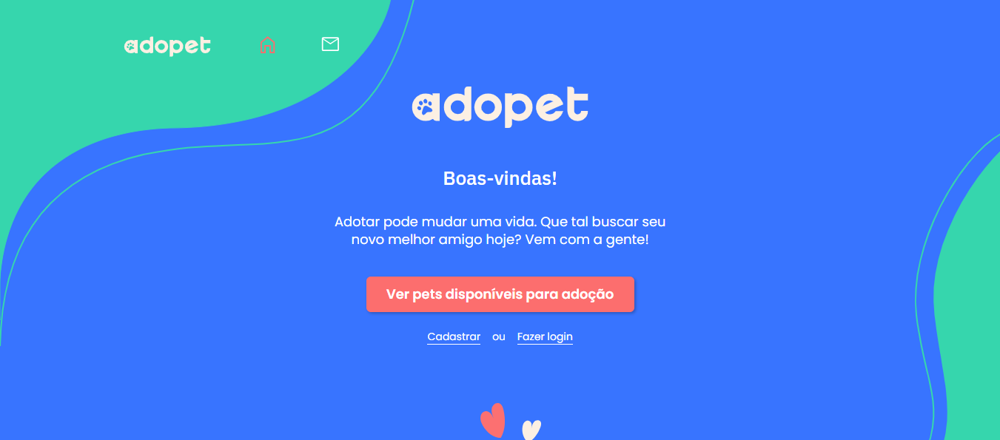

<h1>AdoPet</h1>


<h2> 📝 Resumo do Projeto</h2>

A AdoPet é uma plataforma criada para conectar pessoas interessadas em adoção responsável a pets disponíveis em abrigos e ONGs. O site centraliza informações, facilita a comunicação e incentiva o processo de adoção de forma simples, segura e acessível.



<h3>O que o AdoPet faz:</h3>
<p>🔹Apresenta pets disponíveis para adoção com fotos, perfis e características.</p>
<p>🔹Permite que novos usuários criem uma conta para navegar de forma personalizada.</p>
<p>🔹Oferece login seguro para acessar funcionalidades como envio de mensagens e interesse em adoção.</p>
<p>🔹Conecta adotantes e responsáveis pelos animais de maneira prática dentro da própria plataforma.</p>
<p>🔹Fornece uma experiência simples e intuitiva, com foco em adoção responsável.</p>

<h2>🧪 Tipos de testes automatizados com Cypress</h2>

<h4>✅ 1. Testes de interface (UI)</h4>
<h4>✅ 2. Testes de cadastro de usuário</h4>
<h4>✅ 3. Testes de login</h4>
<h4>✅ 4. Testes de autenticação (API)</h4>
<h4>✅ 5. Testes de navegação</h4>
<h4>✅ 6. Testes funcionais</h4>
<h4>✅ 7. Testes de regressão</h4>

## 🚀 Tecnologias Utilizadas
<div>
   
   
   
   
   
   
</div>

## 📂 Estrutura de Pastas e Arquivos do Projeto

```
├── cypress
│   ├── e2e
│   │   └── api-mensagens.cy.js
│   │   └── api-perfil.cy.js
│   │   └── cadastro-correto-po.cy.js
│   │   └── cadastro-correto.cy.js
│   │   └── cadastro-incorreto.cy.js
│   │   └── cadastro-massa.cy.js
│   │   └── login-correto.cy.js
│   │   └── login-incorreto.cy.js
│   │   └── teste-paginas-adopet.cy.js
│   ├── fixtures
│   ├── results 
│   ├── support
│   ├── videos
├── node_modules
├── .gitignore
├── adopet.png
├── cypress.config.js
├── cypress.env.json
├── package-lock.json
├── package.json
├── README.md
├── roteiro.md
```
## 🛠️ Abrir e rodar o projeto Front end e Back end

Para abrir o projeto no front-end, acesse o site: `https://adopet-frontend-cypress.vercel.app` e para abrir o projeto no back end, acesse o site: `https://adopet-api-i8qu.onrender.com/adotante`


## 🛠️ Abrir e testar o Cypress

Para abrir e testar os arquivos no cypress pelo terminal, execute o comando `npx cypress run` e para abrir e testar os arquivos na interface do cypress, execute o comando `npx cypress open` para iniciar o teste.


## Desenvolvedor
<br>Ronaldo Cesar
